# 凝胶智检系统用户手册

本手册面向三类使用者：

- **实验员**：新建并启动试验，盯着试验进行，处理异常。
- **分析员**：复核算法没有把握的试管，签署报告，查看审计。
- **管理员**：管理账号、模板和仪器设置，导出数据。

软件界面支持简体中文、繁體中文和 English，随时在顶部状态栏切换。手册配图都是软件运行时的真实截图，繁体和英文界面的样子见 [第 12 节](#12-界面语言)。

> 软件内部的数据（试验记录、审计记录）会按操作发生时的语言原文保存，所以英文和繁体界面里审计追踪的“操作记录”仍是简体中文原文。

## 目录

1. [安装和首次启动](#1-安装和首次启动)
2. [登录和锁屏](#2-登录和锁屏)
3. [界面总览](#3-界面总览)
4. [新建试验：扫码和管位](#4-新建试验扫码和管位)
5. [监控和告警](#5-监控和告警)
6. [单管详情和人工复核](#6-单管详情和人工复核)
7. [签署和验签](#7-签署和验签)
8. [报告导出](#8-报告导出)
9. [历史记录和审计追踪](#9-历史记录和审计追踪)
10. [用户管理（管理员）](#10-用户管理管理员)
11. [仪器设置（管理员）](#11-仪器设置管理员)
12. [界面语言](#12-界面语言)
13. [常见问题](#13-常见问题)

## 1. 安装和首次启动

### 安装

- **Windows**：解压发布包的 zip，双击 `GelInspect.exe`；或运行安装程序（按当前用户安装，不需要管理员权限）。第一次运行 Windows 可能提示“已保护你的电脑”，点“更多信息”→“仍要运行”。
- **macOS**：打开 `.dmg`，把 `GelInspect` 拖进“应用程序”。第一次打开请在 Finder 里**右键（或按住 Control 点按）→ 打开 → 打开**；之后双击即可。若提示“已损坏”，见 [部署说明](deployment.md) 的放行步骤。
- **用仓库启动**（开发和演示）：装好 [uv](https://docs.astral.sh/uv/) 后，在仓库目录运行 `uv run gelinspect`。

软件完全离线运行，不会联网。

### 首次启动

正式部署的第一次启动，软件显示**创建管理员**页：设置管理员的登录名、显示名称和密码（至少 8 位）。这个密码是你自己设的，数据库里没有任何默认账号和默认密码。

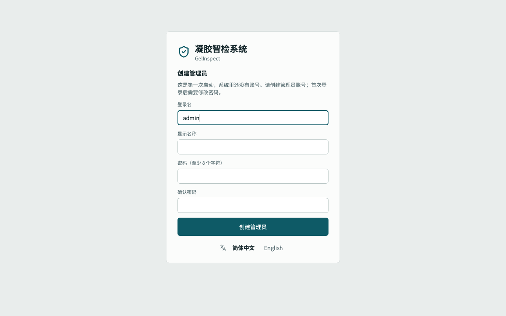

数据（数据库、录像、图像、报告、日志、密钥）放在固定目录：Windows 是 `%LOCALAPPDATA%\GelInspect`，macOS 是 `~/Library/Application Support/GelInspect`。备份时先关闭软件，再复制整个目录；换电脑的注意事项见 [部署说明](deployment.md)。

> 演示包和 `uv run gelinspect` 会自动创建三个演示账号（admin、experimenter、analyst，密码都是 12345678）；加启动参数 `--demo` 时登录页会显示这三个账号，点一下即可填入。**演示账号的密码是公开的，不要用于真实检测。**

## 2. 登录和锁屏

在登录页输入用户名和密码。右上角可以切换语言。

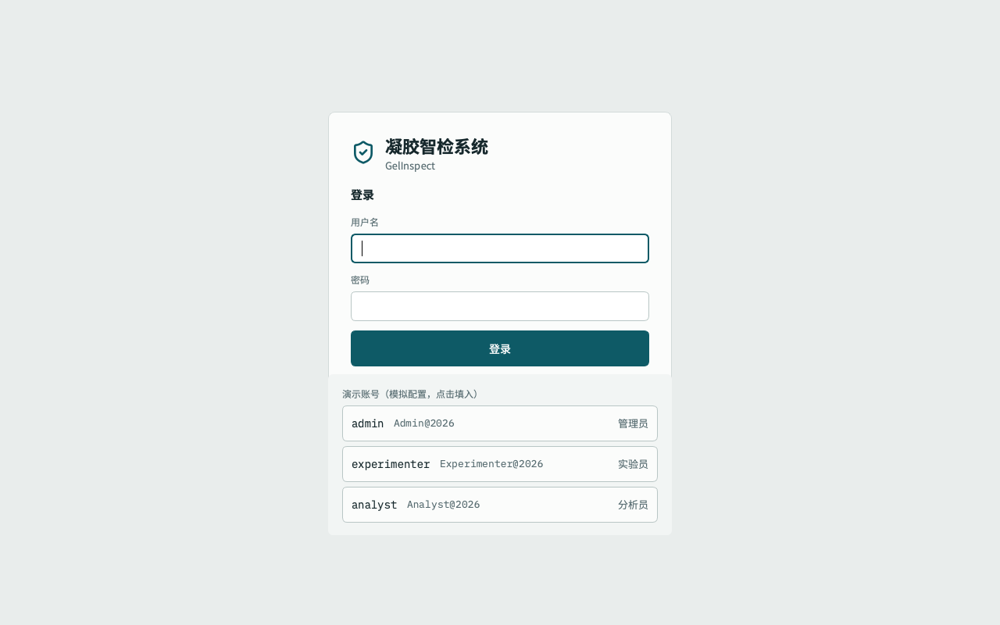

- **连续输错密码 5 次，账号锁定 5 分钟**，期间连正确的密码也不能登录，页面会显示倒计时。
- 管理员代你设置了初始密码，或重置过密码时，第一次登录必须先修改密码。
- 登录后右上角的用户菜单可以：修改密码、锁定屏幕、退出登录。

**锁屏**：无操作超过 15 分钟（管理员可在配置里改），或手动点“锁定屏幕”，软件进入锁屏页。**正在运行的试验在后台继续**，不受影响；输入自己的密码即可解锁。锁屏时如果有试验在进行，软件不允许关闭。

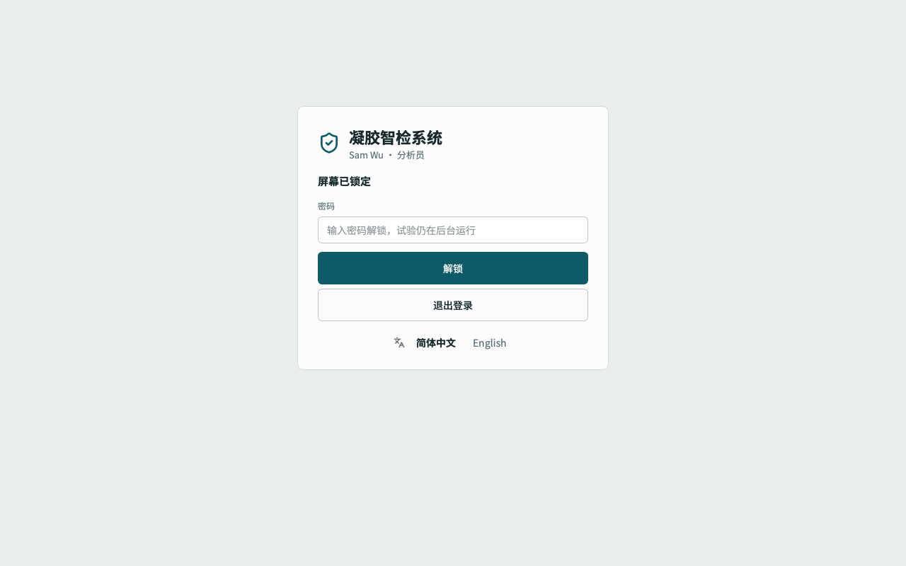

## 3. 界面总览

- **顶部快捷栏**：新建试验、打开文件、检测模板、打印报告、审计追踪、仪器设置，旁边是仪器连接状态、语言和用户菜单。每个按钮有键盘快捷键（macOS 是 ⌘ 加字母，Windows 是 Ctrl 加字母，鼠标放上去会显示）。当前角色没有权限的按钮是灰的。
- **左侧菜单**：点左上角的菜单按钮展开，可以固定。页面有：工作台、新试验、试验监控、历史记录、模板管理、试剂溯源、报告中心、审计追踪、用户与权限、仪器设置、关于。没有权限的页面灰显。
- **工作台**：检测室温度曲线、进行中的试验、最近结果、需要处理的事项（待复核、异常试验、试剂过期）。

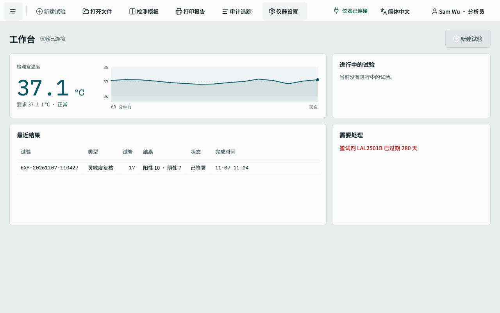

三种角色能做的事：

| 功能 | 实验员 | 分析员 | 管理员 |
|---|---|---|---|
| 新建、启动、停止试验，试剂校验 | 可以 | – | – |
| 人工复核单管结果 | – | 可以 | – |
| 签署试验和报告 | – | 可以 | – |
| 预览、打印报告，验签 | 可以 | 可以 | 可以 |
| 导出 Excel 和批量导出报告 | – | 可以 | 可以 |
| 查看审计追踪 | – | 可以 | 可以 |
| 管理模板 | – | – | 可以 |
| 用户与权限、修改仪器设置 | – | – | 可以 |

“用户与权限”页底部有完整的角色权限表。

## 4. 新建试验：扫码和管位

实验员点“新建试验”，向导分四步。

### 第 1 步：选择模板

软件内置四类试验的模板，管位布局按中国药典通则 1143：灵敏度复核（2λ:1，18 管，含 2 支阴性对照）、干扰试验（28 管）、半定量试验（20 管）、限度试验（8 管），以及限度试验一阳一阴时用的“限度试验（复试）”（10 管）。另有“通用检测（96 管）”：96 支管都是样品，每支管按凝固状态直接给出阴阳性（完全凝固阳性、未凝固阴性、部分凝固待人工复核），不做试验级判定，结论显示“不适用”，复核完即可签署；也不需要鲎试剂的标示灵敏度。每支管都标明用途（供试品、供试品阳性对照、阳性对照、阴性对照、内毒素标准系列等）。管理员还可以在“模板管理”里增加自己的模板。

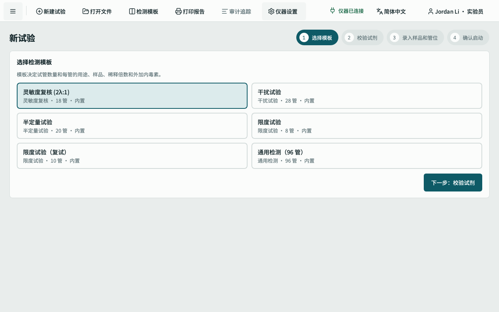

### 第 2 步：校验试剂（扫码）

依次校验**鲎试剂、内毒素、检查用水**三种试剂。点输入框后用扫码枪扫试剂上的码（扫码枪会自动回车），也可以手输后按回车。校验结果显示批号、是否备案、有效期和剩余天数；鲎试剂还会显示标示灵敏度。三张卡都“已通过”才能进入下一步。

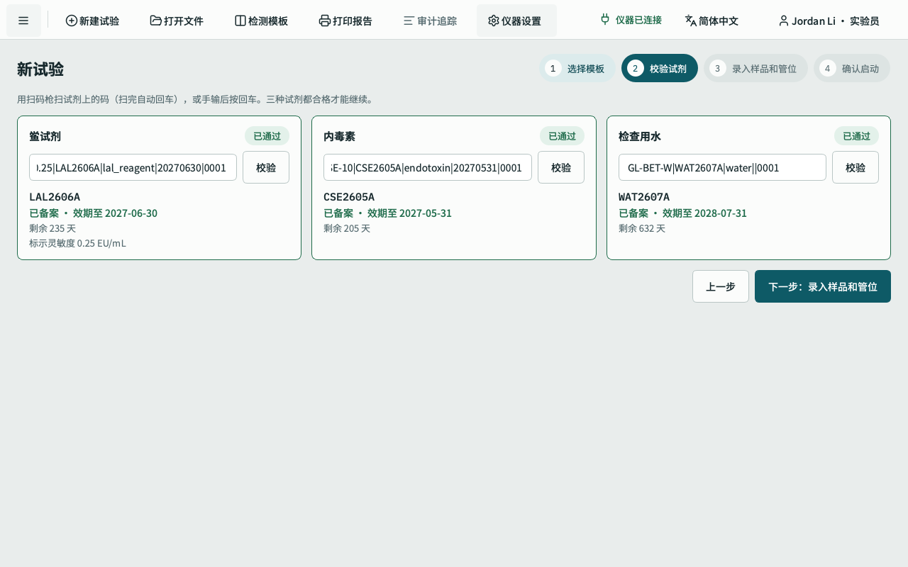

**过期、未备案、有效期未知的试剂会锁定流程**：弹出“试剂未通过校验”提示窗并在页面上显示红色横幅，写明哪种试剂、哪个批号、什么原因，“下一步”不可点，每次扫码都记入审计。点“知道了”关闭提示窗后再操作。请换合格的批次后重新扫码。把试剂放错位置（例如在鲎试剂卡扫了内毒素的码）或读不出码，只提示重扫，不算锁定。

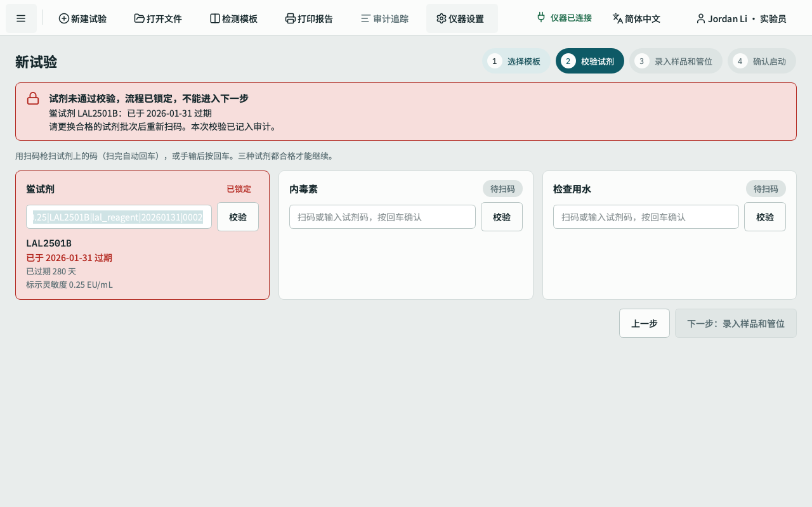

### 第 3 步：录入样品和选择管位

- 左边表格填样品名称和样品批号（名称必填）。灵敏度模板的“外加内毒素”由鲎试剂的标示灵敏度 λ 自动算出（2λ、λ、λ/2、λ/4），不能手改。
- 右边是 12 排 × 8 支的孔板（96 个管位，每排一竖列，列头 Row01～Row12）：**点一个孔选中它，再点一次取消**。“自动选择”按模板默认的管号选，“全部清除”清空。右上角显示“已选 n / N”和“管位已对应”。选的管数必须与样品行数一致才能下一步。
- 选中的管号从小到大依次对应表格的样品行。
- 可选填 MVD 和内毒素限值，会写入报告。

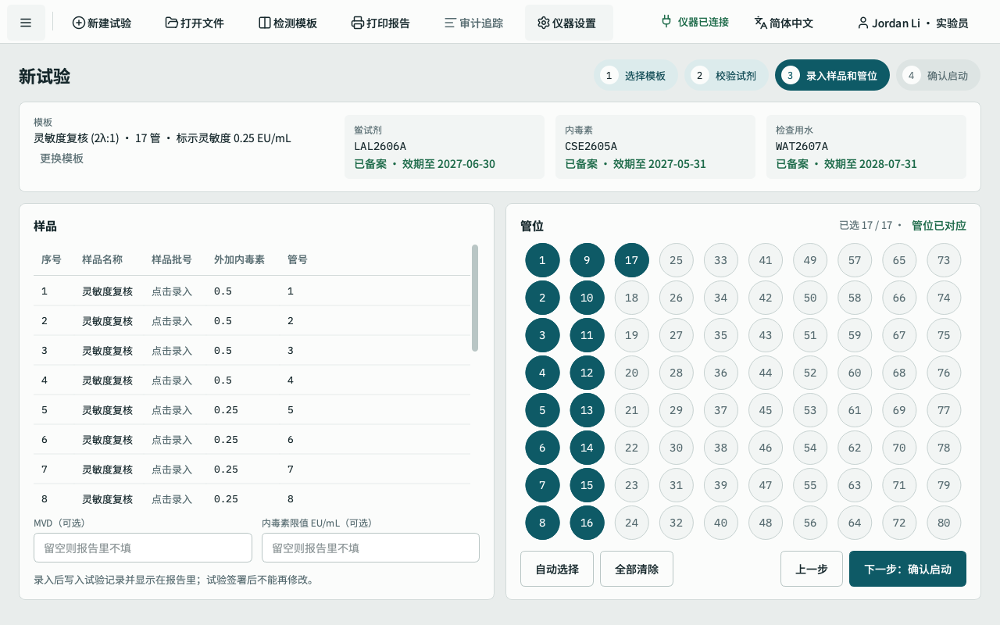

### 第 4 步：确认并启动

核对汇总后点“确认并启动”。引擎会检查设备、温度和视频；检查不通过时横幅写明原因，试验仍是“就绪”，处理好后点“重试启动”即可。启动成功后自动进入试验监控页。

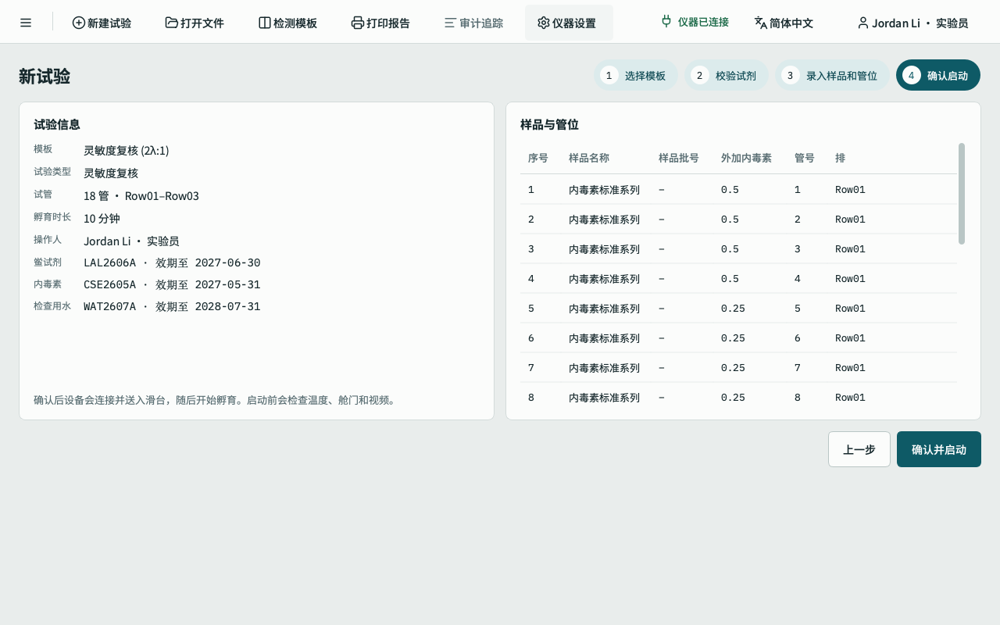

返回上一步不会丢数据。离开没填完的向导（切换页面、退出登录）时软件会先请你确认。

## 5. 监控和告警

启动后试验按下面的顺序自动进行，每排（Row01–Row12，每排最多 8 支）独立计时：

**孵育 → 读数（翻转并拍照）→ 分析 → 待复核 / 已完成**

试验监控页从上到下是：告警横幅、标题行（模板名、试验编号、状态、实时温度、“停止试验”）、信息卡（三种批号、标示灵敏度 λ、操作人、开始时间）、四个标签页。

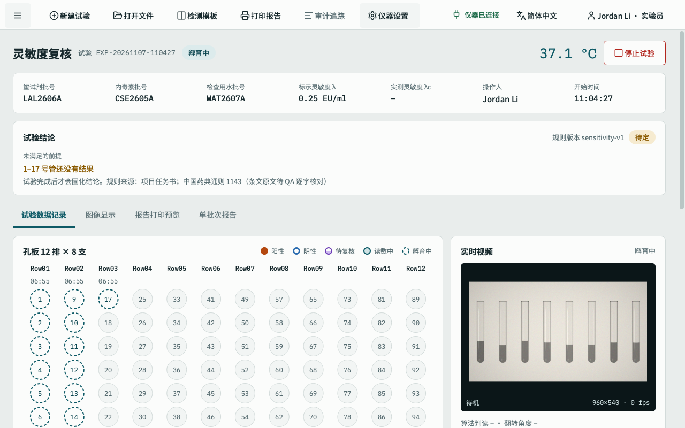

- **孔板**：每个孔的颜色表示状态：阳性（实心）、阴性（空心）、待复核（紫色）、读数中、孵育中（虚线）。每排下面是倒计时 mm:ss，到点后依次显示“读数中”“分析中”“已读数”。点一个孔进入单管详情。
- **实时视频**：显示当前排的画面、翻转状态、帧率、算法判读耗时和翻转角度；“回放第 N 排”可以回看已读数那一排的录像。
- **四个标签**：试验数据记录（孔板和结果表）、图像显示（每排翻转前后的整排原图）、报告打印预览、单批次报告（见第 7、8 节）。

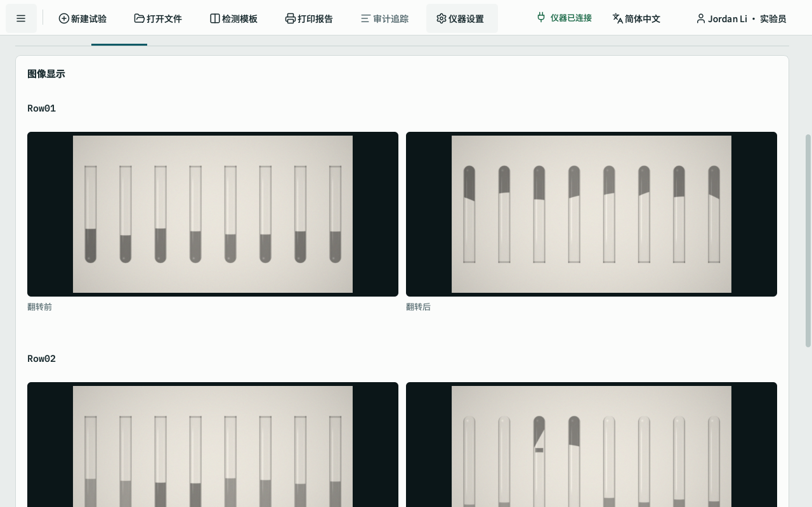

**多排同时到点时按顺序读取**，后面的排可能比到时晚几十秒才读数；晚得太久时会有告警提示，读数的实际时间会如实记录。

### 告警

出现问题时页面顶部显示告警横幅，同时右上角弹出提示：温度超出范围、视频断流或画面异常、设备故障、舱门被打开、算法分析超时或失败、数据库被占用等。条目可以手动关闭，问题恢复后（如温度回到范围内、视频已重连）自动消失。英文和繁体界面的告警显示概要，具体数值和原因见审计追踪。

### 停止、异常和恢复

- **停止试验**：点右上角“停止试验”并确认。已读数的结果保留，试验状态变为“已停止”，不能恢复。
- **异常**：设备、视频或温度出问题时试验进入“异常”状态，页面给出原因。
  - **恢复试验**：确认问题已排除后点“恢复试验”。读数失败的排会重新翻转（注意：翻动过的凝胶状态可能已经改变，请按质量规程判断是否可以复测）；分析失败的排用保存的原图重新分析。
  - **重试分析**：只重新分析，不翻转。软件重启后也可以对已拍照的排重试。
  - 软件重启时仍在运行的试验会被标记为异常，之后只能重试分析或停止。
- 试验结束（待复核或已完成）后，监控页变成只读回看：没有停止按钮，右侧改为“按排回放”。

## 6. 单管详情和人工复核

在孔板上点一个孔，或在结果表里双击一行，进入单管详情。

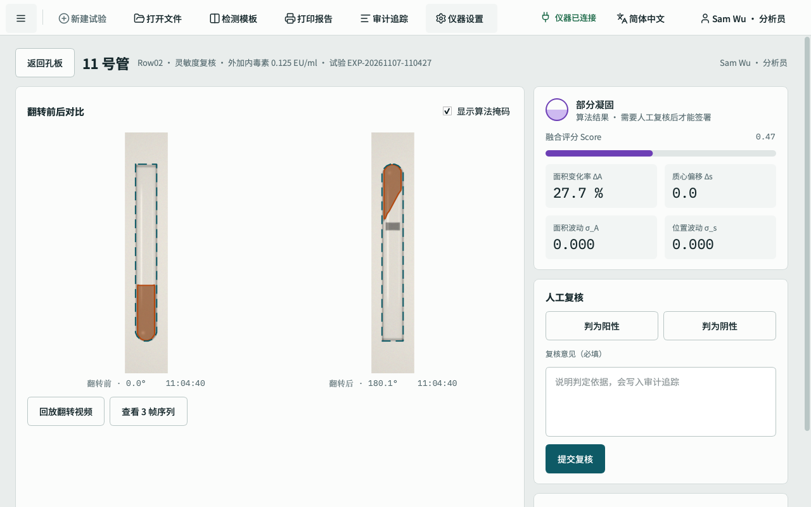

- **翻转前后对比**：左边翻转前、右边翻转后的试管放大图。勾选“显示算法掩码”可以看到算法认定的凝胶区域（橙色）和试管轮廓（虚线）。“回放翻转视频”“查看 3 帧序列”可以看更多细节。
- **判读**：算法给出的状态——完全凝固、部分凝固、未凝固——以及融合评分、面积变化率 ΔA、质心偏移 Δs、面积波动 σ_A、位置波动 σ_s。数值缺失（凝胶缺失的试管常见）显示为“–”。
- **判读过程**：列出每项特征的测量值、归一化得分 f（0–1，越大越像凝胶）、权重 ω 和贡献 ω·f，各项相加就是融合评分 Score。评分条上的两条竖线是未凝固阈值和完全凝固阈值，下方写明三段的范围；最后一行是这支管“凝固状态 → 阴阳性”的换算结果。
- **判读依据**：点“判读依据”打开说明：药典凝胶法的判读标准、阳性和阴性的示例照片、软件的判读步骤，以及当前配置的凝固状态与阴阳性对应关系。

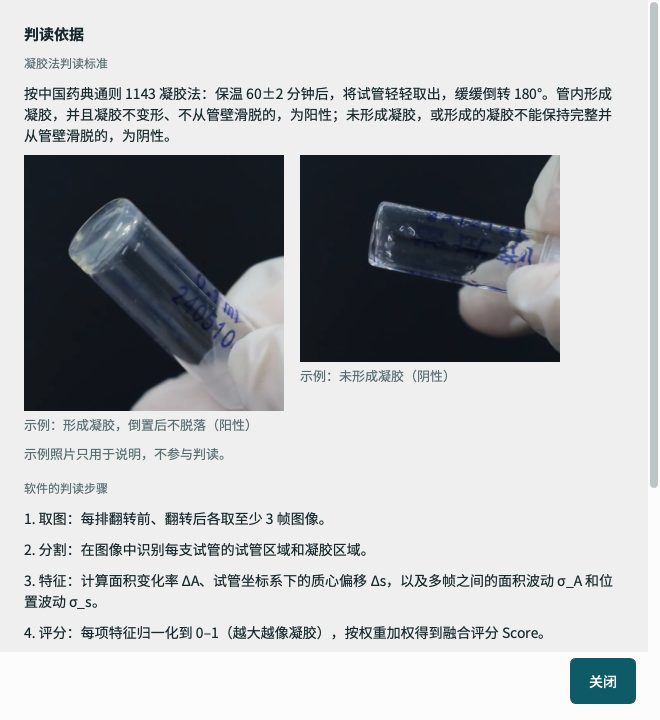

- **默认判读规则**：完全凝固 = 阳性，未凝固 = 阴性，**部分凝固 = 待复核**。算法没有给出状态、图像质量不足、找不到试管、分析失败的试管，也一律是待复核。**软件绝不会把无法判定的试管默认判为阴性。**

### 人工复核（分析员）

待复核的试管需要分析员判定：

1. 点“判为阳性”或“判为阴性”。
2. 在“复核意见”里写判定依据（必填，会写入审计）。
3. 点“提交复核”。

复核后判读区显示“算法：部分凝固 → 人工：阳性”以及复核人、时间和意见；**算法的原始结果永远保留，不会被覆盖**，试验的阴阳性以复核结果为准。**最后一支待复核的试管处理完，试验自动变为“已完成”**，才可以签署。

只有分析员能复核，而且只有试验处于“待复核”状态时才能提交；其他情况下按钮旁会说明原因。

复核完成后试验变为“已完成”。监控页显示每支管的凝固状态（孔的颜色）、阴阳性和“已复核”标注：

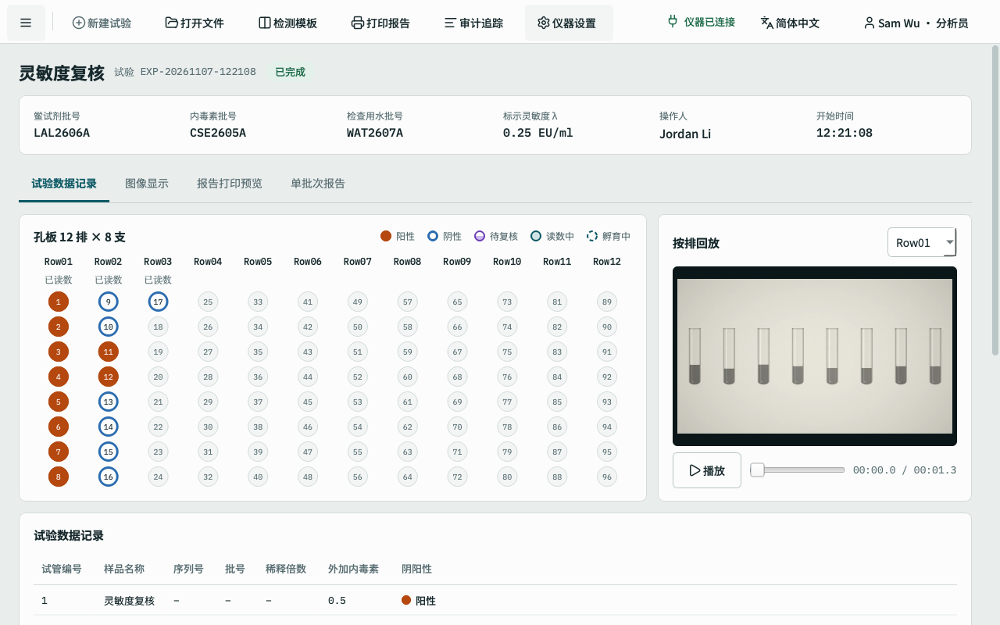

## 7. 签署和验签

### 签署（分析员）

试验“已完成”（所有待复核管都已处理）后，分析员可以签署：

1. 打开“报告中心”，在右上角选择试验，确认预览内容无误。
2. 在“签署和导出”里选择报告语言（简体中文、繁體中文或 English），点“签署并生成 PDF”。
3. 在对话框里**再次输入自己的密码**确认身份，点“签署”。

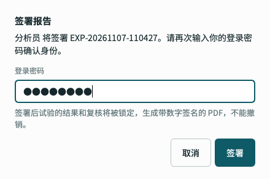

签署会生成带数字签名的 PDF 报告，试验状态变为“已签署”并**锁定，不能再修改**。密码错误不会签署，对话框保持打开并说明原因。

### 验签

任何角色都可以在报告中心点“重新验签”。通过时显示“验签通过”：签名完整、覆盖整个文件、证书是本机信任的那一张，文件与库里记录一致。点“验证外部 PDF…”可以检查拷贝出去的报告文件。文件被改动过哪怕一个字节，验签都会失败并说明原因。

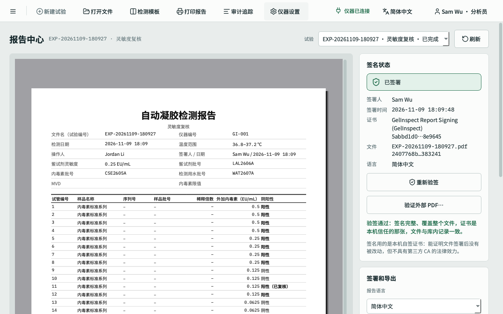

> 重要：签名使用本机自签证书，**能证明文件签署后没有被改动，并且是由本机这把密钥签署的，但没有第三方 CA 的法律效力**。需要法律效力时，请联系实施人员更换为 CA 证书。

## 8. 报告导出

### 单个试验

报告中心左边是 A4 报告预览，显示文件名、检测日期、温度范围、仪器编号、操作人、签署人和日期、鲎试剂灵敏度、三种批号、MVD、内毒素限值、结果表。右侧：

- **打印**：直接打印（有打印机时）；
- **导出已签名 PDF**：把已签署的 PDF 导出到指定位置（同一份签名文件，可反复导出）；
- **导出 Excel 数据…**：导出这个试验的结果（试验汇总、每管结果含阴阳性和复核信息）。

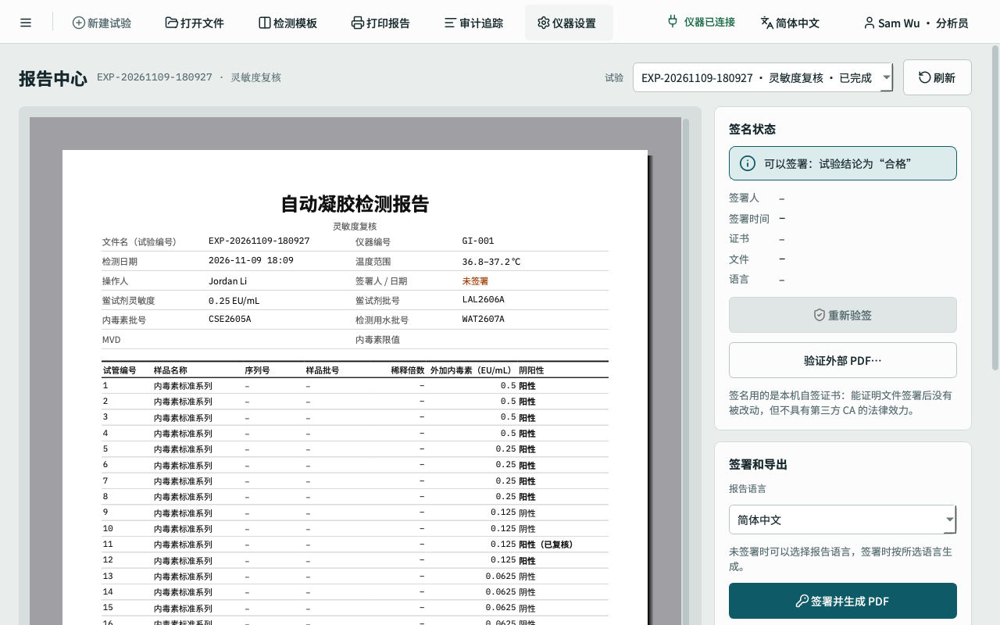

### 单批次报告

同一鲎试剂批号（或其他批号）的多次试验可以汇总成一份单批次报告：切到“单批次报告”标签或报告中心右侧的“单批次报告”卡，选批号类型和批号后点“预览单批次报告”。**批次内所有试验都已签署后才能签署单批次报告。**

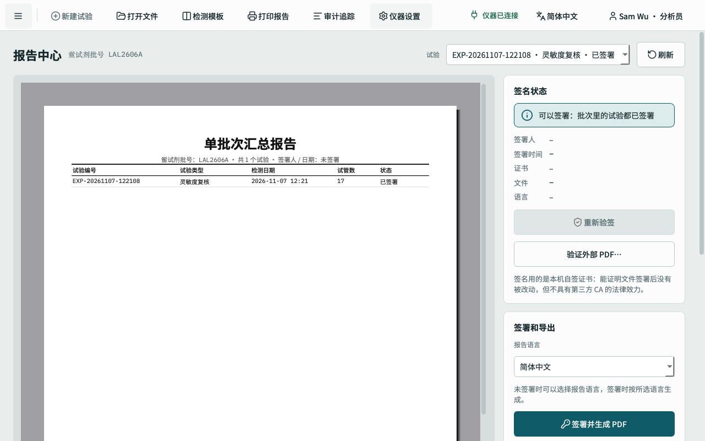

### 批量导出

点“批量导出…”，勾选已签署的报告，选目录，导出 PDF 和一份清单 CSV。每份文件导出前都会与库里的 SHA-256 核对，被改动或缺失的不导出并在清单里标明。

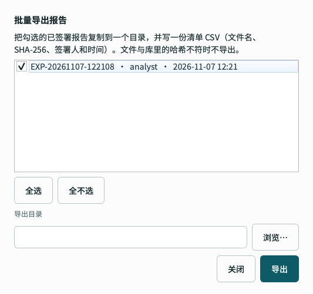

如果管理员在仪器设置里打开了“敏感导出加密”，Excel 和批量导出的内容会打成**带密码的 AES-256 加密 ZIP**，每次导出前设置密码（至少 8 个字符）。请用 7-Zip、Keka 等工具解压，系统自带的解压不支持这种加密。密码丢失无法找回。

## 9. 历史记录和审计追踪

### 历史记录

按试验类型、时间段、批号、状态、操作人筛选，每页 20 条，最新的在前。双击一行打开试验（只读回看）。选中若干行后可“导出所选结果”，“导出当前列表”导出符合当前条件的**全部**试验（不只当前页）。

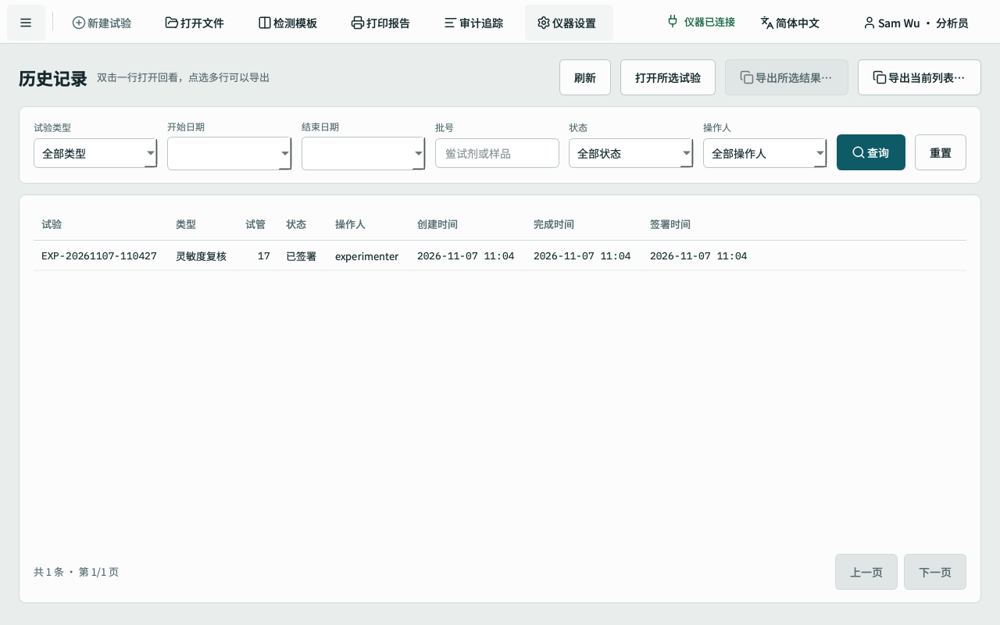

### 审计追踪（分析员、管理员）

记录登录、试剂校验、试验启动和停止、复核、签署、导出、用户和设置变更等每一次关键操作。字段是序号、操作者、时间、权限（操作时的角色）、操作记录。可以按时间段、操作者和关键字查询，也可以导出 Excel。

点“校验完整性”检查审计记录有没有被改动或删除：通过时显示绿色横幅“校验通过：哈希链完好”；不通过时红色横幅指出**第一处异常的序号**和原因。

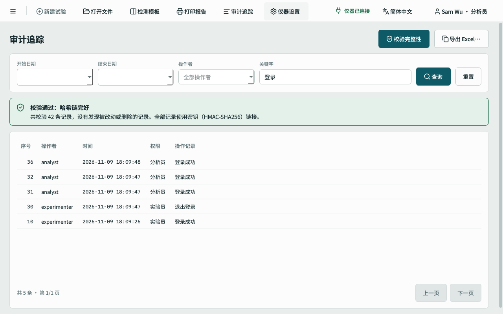

审计记录只能追加，不能修改和删除。查看和导出审计本身也会留下记录。

## 10. 用户管理（管理员）

“用户与权限”页列出全部账号。

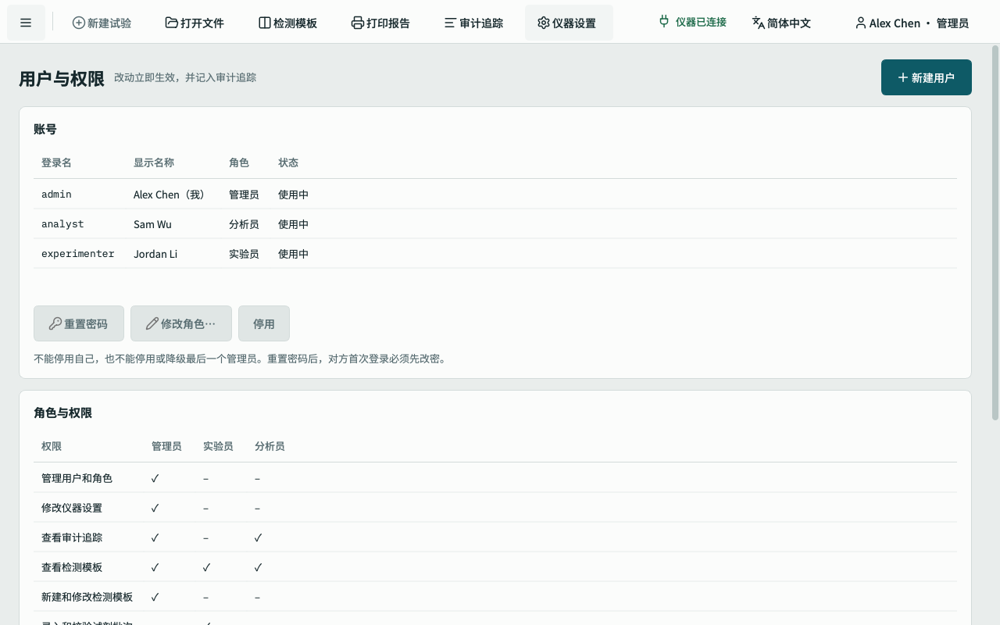

- **新建用户**：填写登录名、显示名称和角色，初始密码可以留空（自动生成 12 位临时密码）。**临时密码只在对话框里显示一次**，请当面交给本人；新账号第一次登录必须改密。
- **重置密码**：同样生成临时密码，对方首次登录必须改密。
- **修改角色**：改动立即生效，对方已登录的会话也立即采用新角色。
- **停用 / 启用**：停用后对方已登录的会话立即失效。
- 不能停用自己，也不能停用或降级最后一个管理员。

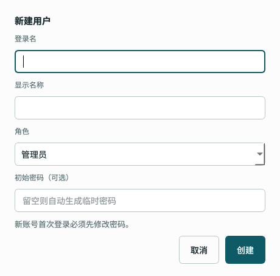

**模板管理**：管理员可在“模板管理”页新建、复制、编辑自定义模板（名称、类型、每管的样品名、稀释倍数、外加内毒素或 λ 倍数、用途，1–96 管）。内置模板只读，可以复制后再编辑。

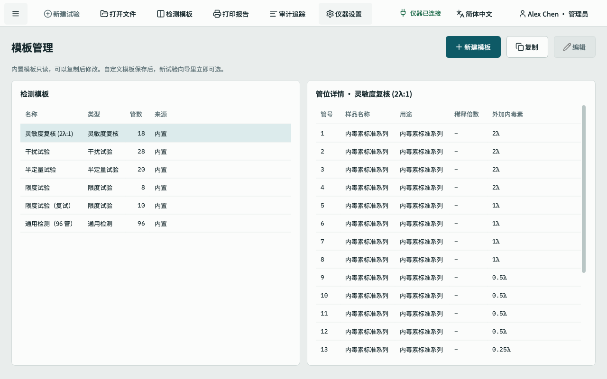

**试剂溯源**：所有角色可查看已录入的试剂批次（过期整行红色、30 天内到期黄色）和每次扫码校验的记录，也可以单独扫码查询。

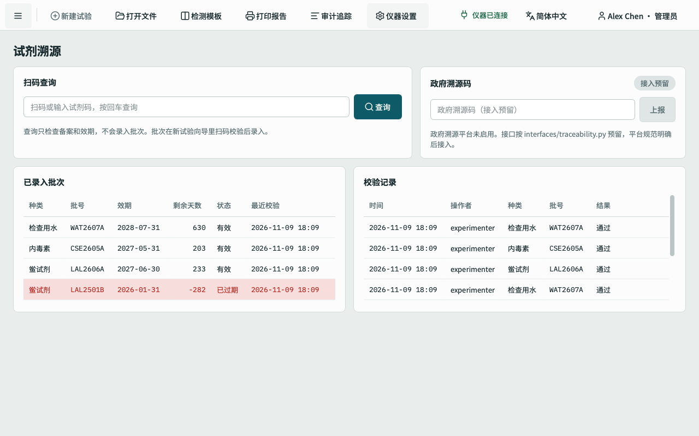

## 11. 仪器设置（管理员）

所有角色都能查看，只有管理员能修改。改动在**之后启动**的试验生效，每项改动的旧值和新值都写入审计。

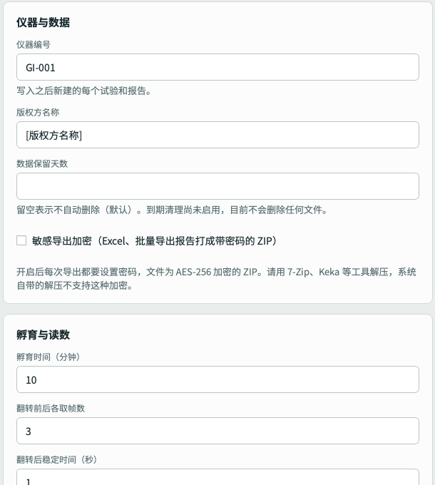

| 设置项 | 范围 | 试验进行中 |
|---|---|---|
| 仪器编号 | 1–64 个字符，写入之后新建的每个试验和报告 | 可以改 |
| 版权方名称 | 1–120 个字符，写入每份报告的页脚。**请在正式使用前改成真实名称**，默认是占位文字 | 可以改 |
| 数据保留天数 | 留空表示不自动删除（默认）。自动清理尚未实现，目前不会删除任何文件 | 可以改 |
| 敏感导出加密 | 开 / 关 | 可以改 |
| 孵育时间（分钟） | 0.1–1440 | 不能改 |
| 翻转前后各取帧数 | 3–20 | 不能改 |
| 翻转后稳定时间（秒） | 0–10 | 不能改 |
| 目标温度和允许偏差 | 20–45 ℃，±0.1–5 ℃ | 不能改 |
| 视频输入 | 沿用配置文件 / 视频文件 / 图片文件夹 | 不能改 |

“视频输入”可以浏览选择视频文件或图片文件夹，点“预览”读取第一帧并显示分辨率和帧率。**目前不支持实时摄像头**，工业相机型号确定后接入。

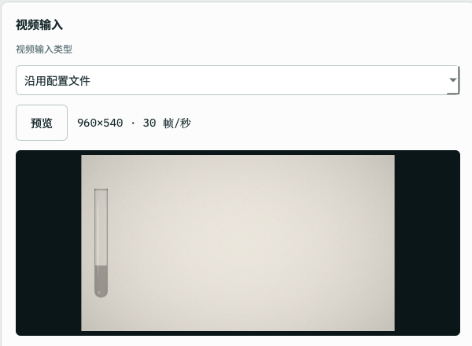

有不合法的项时，保存会一次列出所有问题，一项都不写入。

## 12. 界面语言

点顶部状态栏的语言按钮，在下拉菜单里选择“简体中文”“繁體中文”或“English”，立即生效并记住选择，登录页、锁屏页也能切换。第一次启动时，如果操作系统的语言是繁体中文（台湾、香港、澳门），默认就是繁体中文。

繁体中文使用台湾习惯的用词（例如“稽核軌跡”“範本”“影片”），引号用“”，标点用全角。报告和 Excel 导出也有繁体：报告的语言单独选择（签署时决定，签署后固定），Excel 的表头跟随当前界面语言。

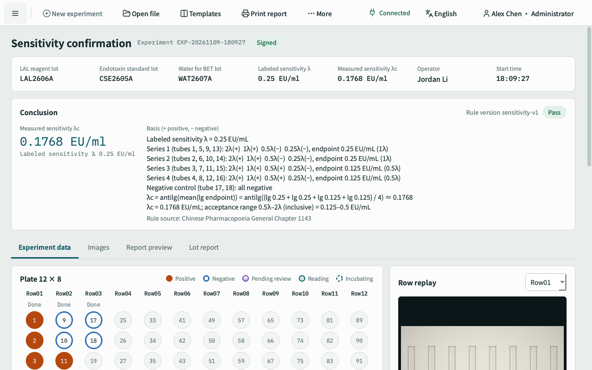

## 13. 常见问题

**登录页提示账号被锁定？** 连续输错 5 次会锁定 5 分钟，等倒计时结束再试；忘记密码请联系管理员重置。

**“下一步”点不了，页面一片红？** 试剂校验没通过，红色横幅写了原因（过期、未备案等），更换合格的批次后重新扫码。

**提示“数据库正忙”？** 另一个操作正在写数据，稍等几秒再试；试验不会因此中止。

**孔显示紫色“待复核”，试验不能签署？** 请分析员逐支复核。所有待复核的管处理完，试验才变为“已完成”。

**签署按钮是灰的？** 报告中心的状态横幅会逐条写出原因：还有待复核的管、有管没有结果，或试验还没有完成。

**试验提示“异常”？** 看监控页顶部的原因（温度、视频、设备、舱门……）。问题排除后点“恢复试验”；不需要继续就点“停止试验”。

**某一排“晚于到时”才读数？** 12 排同时到点时按顺序读取，后面的排会晚一些，实际读数时间已如实记录。是否符合规程时限，请按质量规程判断。

**验签失败？** 说明文件在签署后被改动，或不是本机签署的。请重新从软件里导出原始报告；怀疑数据被篡改请联系管理员并保留文件，同时在审计追踪里“校验完整性”。

**换了电脑，旧报告还能验签吗？** 能。但旧的签名私钥、审计链密钥在新电脑上解不开，迁移步骤见 [部署说明](deployment.md) 的“备份与升级”。

**软件无法启动？** 会弹出对话框说明原因和处理方法；日志在数据目录的 `logs/gelinspect.log`。

**英文或繁体界面里有些文字还是简体中文？** 审计追踪的“操作记录”、用户自己填写的样品名称等是保存下来的原文，不会被翻译。

**macOS 提示“已损坏，无法打开”？** 没有苹果开发者签名所致，按本手册第 1 节或 [部署说明](deployment.md) 放行。

更多技术细节：[部署说明](deployment.md)、[安全与基础防护](features/security.md)、[算法接口](algorithm-interface.md)。
